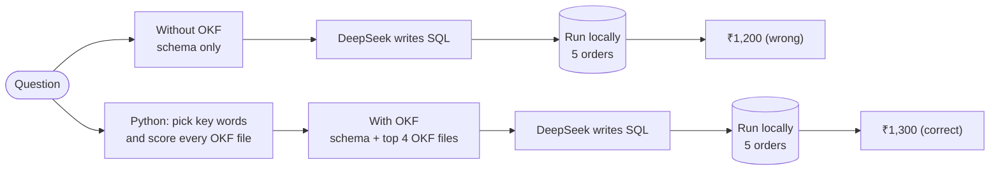

# Open Knowledge Format (OKF): meeting demo

A small project for a 15–20 minute session on Google's
[Open Knowledge Format](SPEC.md) (OKF v0.2; first published by Google Cloud
on 12 June 2026). It shows one idea: **the same
question gets a wrong answer without OKF and a correct answer with OKF.**

## What is in this repo

| Path | What it is |
|------|------------|
| `docs/okf.pptx` | The meeting deck (19 slides, speaker notes included) |
| `bundles/acme_retail/` | The OKF bundle: 5 Markdown files that describe the `sales.orders` SQL table and how revenue is calculated from it |
| `bundles/acme_retail/viz.html` | Open in a browser to see the bundle as a graph |
| `app.py` | Streamlit app: answers a question without OKF and with OKF, side by side |
| `assistant.py` | Loads the bundle, finds matching files, calls DeepSeek |
| `sample_orders.csv` | The example data: 5 orders, queried locally (never sent to the AI) |
| `check_setup.py` | One-shot check to run before the meeting |
| `tests/test_demo_assistant.py` | Unit tests (no network) |
| `SPEC.md` | The OKF v0.2 specification |

## How the demo works

The AI never sees the order data. It only gets the **table schema** (column
names), plus the matching OKF files on the "with OKF" side. It writes a SQL
query, and the app runs that query locally on `sample_orders.csv` (5 orders,
loaded into an in-memory SQLite database).



1. **Find the files (Python, no AI).** `find_concepts()` keeps the important
   words of the question (for example `revenue`, `fiscal`, `year`, `2026`) and
   scores every OKF file by matching words. Title words count most. The top 4
   files are kept, and deprecated files are skipped. The AI never sees the whole
   bundle and never chooses the files.
2. **One call to DeepSeek per side, both at the same time.** The AI replies
   with a SQL query and a one-line explanation of its rule.
3. **Run the query locally.** The result is shown as is: a total and ✅/❌ per
   order for revenue questions, a single number or a table for other questions.
   Each side has a hidden "SQL query the AI wrote" section.

For "What was our revenue in fiscal year 2026?", without OKF the AI guesses an
April–March fiscal year and counts order 1004, which was delivered only 8 days
ago and can still be returned: **₹1,200**. With OKF it reads the revenue policy
(fiscal year = calendar year; delivered **and** 30-day return window closed):
**₹1,300**.

## Run it

```bash
python3 -m venv venv               # Python 3.11 or newer
source venv/bin/activate
pip install -r requirements.txt
echo "DEEPSEEK_API_KEY=your-key" > .env   # your DeepSeek API key
python check_setup.py              # before the meeting: asks one question both ways
python app.py                      # opens http://localhost:8501
```

Questions to try (each button gives a different kind of answer):

| Question | Answer type | Without OKF | With OKF |
|---|---|---|---|
| What was our revenue in fiscal year 2026? | ₹ total | ₹1,200 | ₹1,300 |
| How many orders were placed in fiscal year 2026? | count | 4 | 5 |
| Which delivered orders are not revenue yet? | list | none | 1004 |

You can also type any other question in the input box.

The order data and the bundle stay on your machine. Only the question, the
table schema and the matching OKF files are sent to DeepSeek.

Run the tests with `pip install pytest` and then `python -m pytest -q`.

## The bundle

```
bundles/acme_retail/
  index.md                       contents (read first)
  log.md                         change history
  tables/orders.md               the sales.orders SQL table and its columns
  metrics/revenue.md             what "revenue" means
  metrics/revenue-legacy.md      old definition, status: deprecated (skipped)
  policies/revenue-recognition.md  Finance rules: 30-day return window, calendar fiscal year
  computations/revenue-ytd.md    the approved SQL query
```

## Source

The OKF specification (`SPEC.md`) comes from
[GoogleCloudPlatform/open-knowledge-format](https://github.com/GoogleCloudPlatform/open-knowledge-format)
(Apache 2.0, see `LICENSE.md`). The `acme_retail` bundle is adapted from that
project's example and rewritten around the demo's SQL table.
